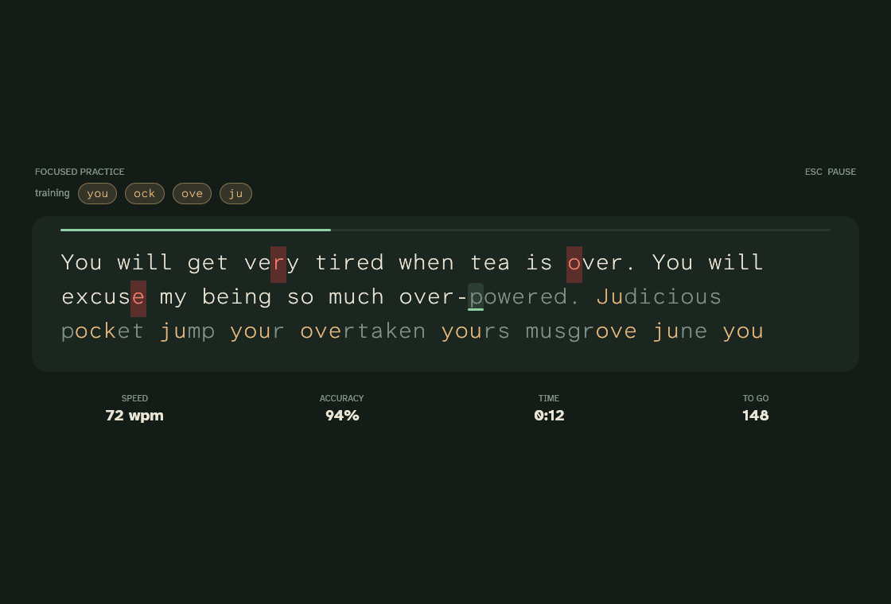
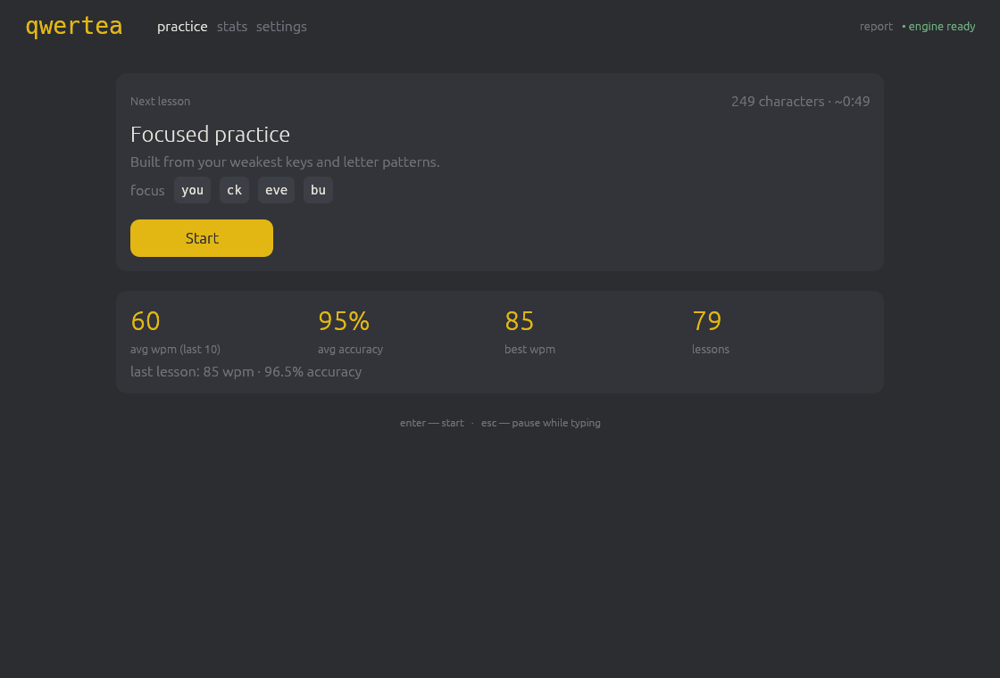
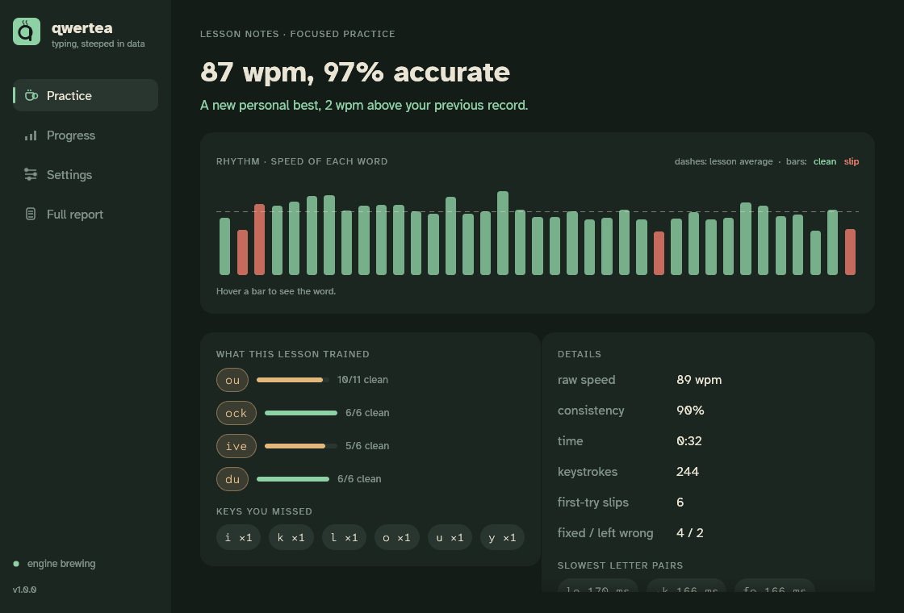
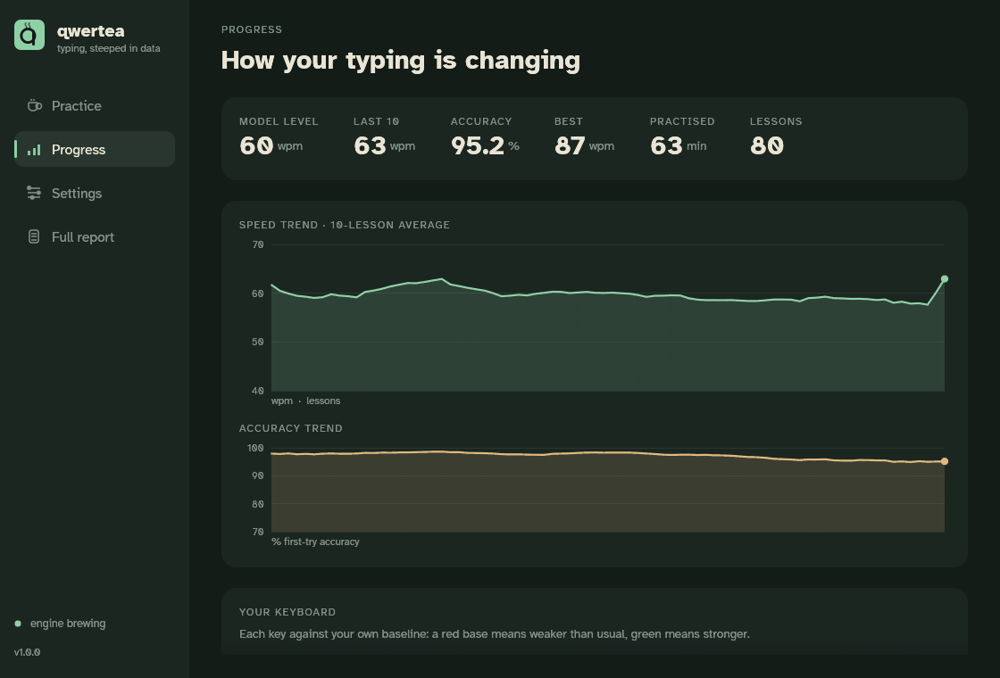
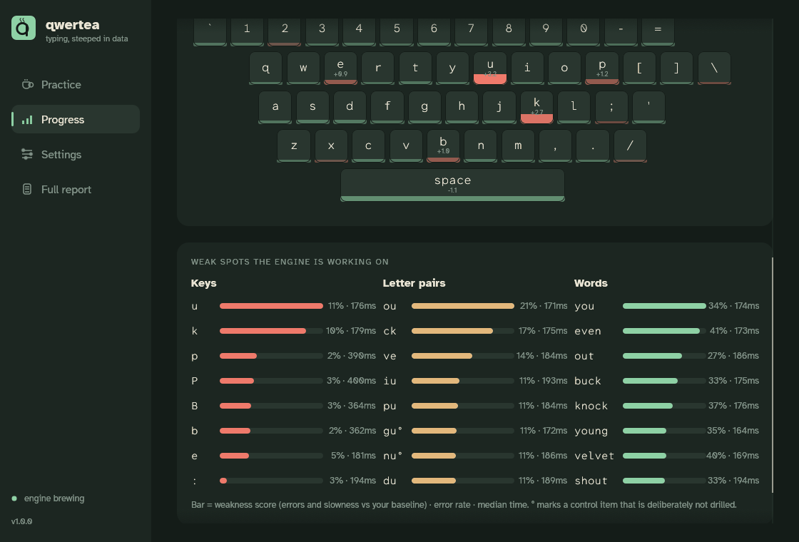
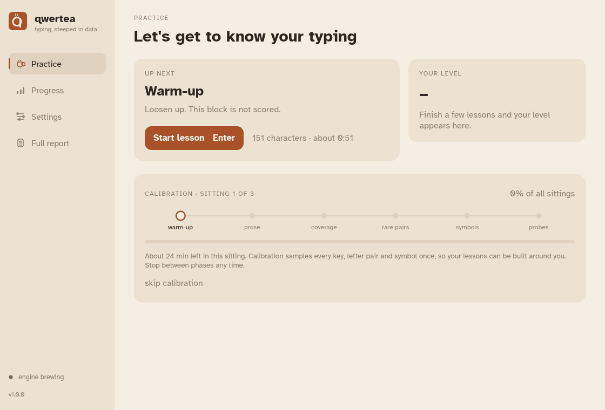
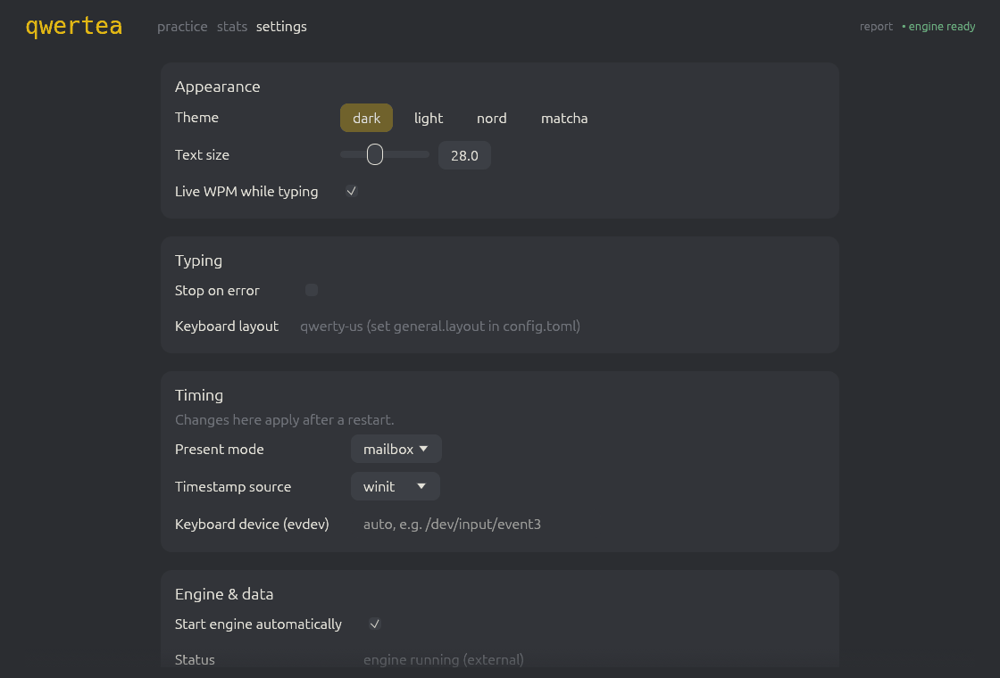
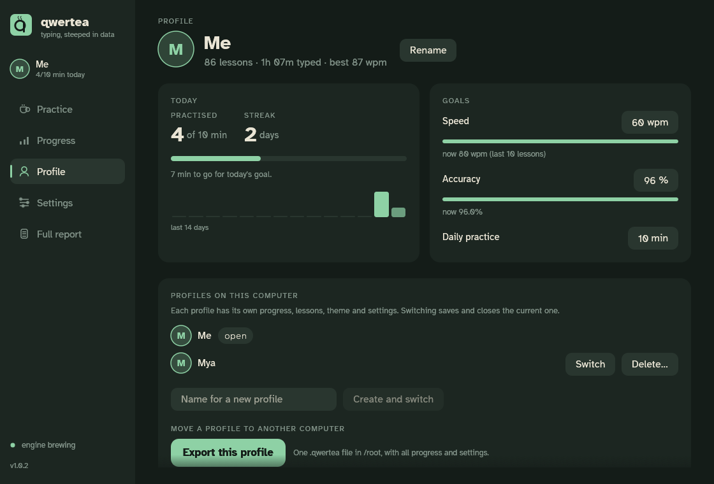
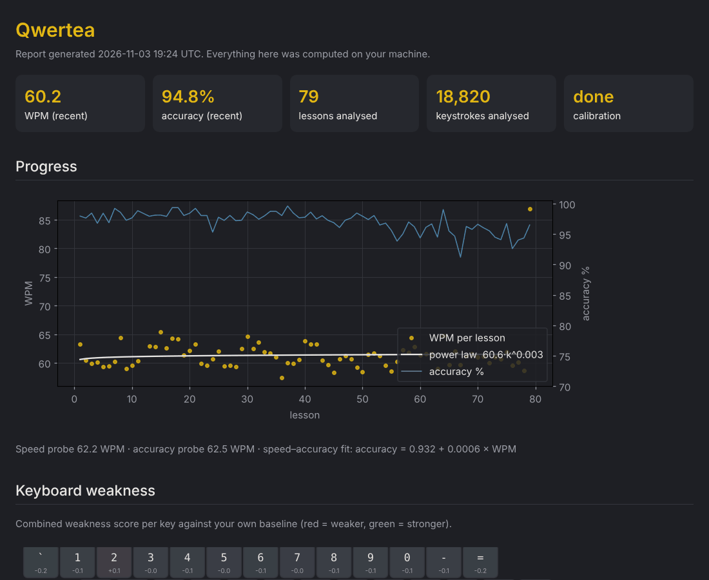

# Qwertea

[](https://github.com/Zwe-Zwe/Qwertea/actions/workflows/ci.yml) · version 1.0.2 · [changelog](CHANGELOG.md)

**A typing tutor that learns your weak spots.** Qwertea is calm and minimal: a sheet of text, a caret and a few honest numbers. But its lessons are not fixed. Each one is brewed from *your* history: the keys, letter pairs and words you get wrong or type slowly, measured against your own baseline by a statistical model that updates after every lesson.

Everything runs locally. No accounts, no cloud, no telemetry.



| | |
|---|---|
|  |  |
|  |  |
|  |  |
|  | |

## Features

- **A quiet typing sheet:** the lesson on a card with a progress edge and an underline caret. **The patterns the lesson is training are tinted in the text still to come**, so you always know what you are practising. Speed, accuracy, time and characters to go sit underneath. Esc pauses, and paused time is never counted; losing window focus pauses automatically.
- **Lesson notes after every lesson:**
  - a plain-language verdict against *your own* recent lessons and personal best;
  - a per-word rhythm strip showing where you sped up, slowed down or slipped;
  - how each trained pattern went ("ock: 6/6 clean");
  - the keys you missed and your slowest letter pairs.
- **Dynamic lessons, not fixed exercises.** After a one-off calibration (3 short sittings that sample every key, letter pair and symbol), every lesson mixes:
  - **focused drill:** real words chosen because they contain your weakest patterns, plus generated pseudo-words for rare letter pairs;
  - **review:** patterns you improved, brought back on an expanding schedule so they stick;
  - **natural prose:** real sentences picked because they contain your targets.
- **Difficulty that follows you:** lesson length, word length and drill share adjust to keep your accuracy in the 92–96 % band.
- **Progress:** your level, speed and accuracy trends, a keycap heatmap against your own baseline, and ranked weak keys, letter pairs and words.
- **A full HTML report** with:
  - a learning curve with a power-law fit;
  - error types;
  - behaviour (slow-down after errors, rhythm, fatigue);
  - whether drilling actually helps, measured against held-out control items;
  - an explainable LightGBM model of what drives your errors and latency.
- **Accurate timing:** keystrokes are timestamped before the UI touches them, and kernel timestamps are optional on Linux. See [docs/timing-validation.md](docs/timing-validation.md).
- **Profiles:** everyone on the computer gets their own progress, lessons, theme and settings. A daily practice goal and a streak; speed and accuracy goals; export a profile to one file and import it elsewhere.
- **Typing your way** (per profile):
  - three fonts, three caret styles and an optional smooth caret;
  - live stats in full, time and words only, or hidden;
  - mistakes: move on, stop on error, or fix before the next word;
  - short, medium, long or custom lessons;
  - capitals, punctuation and numbers on or off;
  - optional key sounds.
- **Honest numbers:** the clock runs from your first keystroke to your last, with pauses excluded, and the live WPM equals the final result. See [D27](docs/decisions.md).
- **Updates from inside the app:** Qwertea tells you when a new version is out. A source install updates itself with one click.
- **Four tea themes** (Sencha, Chai, Earl Grey, Oolong) and Atkinson Hyperlegible type.

## Install

### Arch Linux

```bash
git clone https://github.com/Zwe-Zwe/Qwertea.git
cd Qwertea/packaging/arch
makepkg -si
```

Then start **Qwertea** from your application menu, or run `qwertea`. Once the package is published to the AUR, `yay -S qwertea` works too. See [packaging/arch/README.md](packaging/arch/README.md) for details, the `qwertea-git` package and optional extras.

An installed Qwertea keeps your settings in `~/.config/qwertea/config.toml` and your data in `~/.local/share/qwertea/`.

### From source (any OS)

You need [Rust](https://rustup.rs) (stable) and [uv](https://docs.astral.sh/uv/getting-started/installation/) (Python 3.11+ is installed by uv if needed).

```bash
git clone https://github.com/Zwe-Zwe/Qwertea.git
cd Qwertea
make run
```

`make run` installs the engine's Python dependencies, builds the app in release mode and starts it. The app starts the analysis engine in the background by itself. After the first build, `make run` (or `./client/target/release/qwertea` from the repository folder) starts in a second. Run from a source checkout, Qwertea uses the repository's `config.toml` and keeps its data in `data/`.

Without `make` (e.g. on Windows):

```bash
uv --project engine sync --all-extras
cd client
cargo run --release --bin qwertea
```

**Linux packages:** key sounds need ALSA (`libasound2-dev` to build on Debian/Ubuntu, `alsa-lib` on Arch); build with `--no-default-features` to leave sound out. winit and wgpu need the usual desktop libraries, e.g. on Debian/Ubuntu `libxkbcommon-x11-0`, `libwayland-client0` and a Vulkan or OpenGL driver (`mesa-vulkan-drivers`). They are present on almost every desktop install.

### Updating

Qwertea checks for a new version when it starts and shows **Update available** in the sidebar (Settings → Updates also has *Check now*).
- **Source install:** press **Update now**. The app downloads, builds and installs the new version, then asks you to restart. No terminal needed.
- **Arch package:** press **Copy command** and paste it into a terminal (`yay -Syu qwertea`), or update from your software manager.

To turn the check off, untick it in Settings, or set `[updates] check = false` in `config.toml`.

## How to use it

1. **Calibrate** (about 3 × 15 minutes). Practice shows where you are with a step tracker per sitting. Each phase has a short intro; stop between phases whenever you like, and progress is kept. If you are impatient, *skip calibration* starts adaptive lessons from whatever you have typed so far.
2. **Practise.** Press Enter for the next lesson. *Up next* lists what it trains, each with the model's current error rate for it.
3. **Check progress** under *Progress*, or open the *Full report*.
4. **Profile:** set a daily goal, watch your streak, and add a profile for each person who uses the computer. Settings (theme, fonts, caret, lessons) belong to the open profile and save themselves.

| Key | Action |
|---|---|
| Enter | start / next lesson |
| Esc | pause while typing (then r restart · s skip · q quit to menu); Esc again resumes |
| Backspace | move back one character |

## How it works

Qwertea is two programs that share one SQLite database per profile (`data/qwertea.db` for the first, `data/profiles/<name>/qwertea.db` for others):

```
client/ (Rust)                         engine/ (Python)
window, typing screen,     ──────►     derives keystrokes, fits the model,
keystroke capture          SQLite      writes the next lessons and the report
           ◄──────────────────────────
```

- **Capture:** the client stamps every key event the moment the OS delivers it, before the UI runs. While you type it writes nothing to disk. When the lesson ends, it saves the raw key-down and key-up events in one transaction.
- **Derivation:** the engine turns raw events into labelled keystrokes. That covers:
  - timing: time between keys and how long each key is held, with pauses removed;
  - error type: substitution, slip onto a neighbouring key, transposition, omission or insertion;
  - corrections: how long you took to notice an error and fix it, and how much you slowed down after it.
- **Weakness model:** every key, letter pair, triple and word gets:
  - a **Bayesian error rate** (Beta posterior) that borrows strength from simpler patterns when data is thin (triple → pair → key → your overall rate);
  - a **robust latency score** against your own median.

  The weakness score combines the two.
- **Lesson choice:** **Thompson sampling** draws from those posteriors, so uncertain patterns get explored and confirmed weak ones get drilled. A few weak patterns are deliberately held out as a control group, so the report can show whether drilling really helps. Improved patterns go on a spaced-review ladder.
- **Insight model:** a **LightGBM** model predicts errors and latency from context (finger, hand, row, previous key, rhythm, fatigue). Its SHAP values in the report explain *why* you make mistakes.

The model is checked by a simulated typist with planted weaknesses. The test suite asserts that calibration recovers them and that adaptive lessons target them (`engine/tests/test_sim.py`).

The full design is in [QWERTEA_SPEC.md](QWERTEA_SPEC.md). Every deviation from it is recorded in [docs/decisions.md](docs/decisions.md).



## Configuration

Theme, text size and typing settings belong to each profile and are changed in the app. They are stored in the profile's database. This computer's settings are saved to `config.toml` (comments kept):

| Key | Default | Meaning |
|---|---|---|
| `general.layout` | `qwerty-us` | keyboard layout (data file in `engine/data/layouts/`) |
| `client.present_mode` | `mailbox` | `mailbox` / `immediate` / `fifo` |
| `client.timestamp_source` | `winit` | `evdev` for kernel timestamps (Linux, see below) |
| `lesson.accuracy_target` | `[0.92, 0.96]` | difficulty control band |
| `lesson.lesson_chars` | `[150, 300]` | lesson length range |
| `calibration.sittings` | `3` | 1–3 calibration sittings |
| `engine.autostart` | `true` | start the engine with the app |
| `updates.check` | `true` | look for a newer version at start-up |

### Kernel timestamps (Linux, optional)

For the most accurate timing, build with `--features evdev-capture` and set `timestamp_source = "evdev"`. Reading `/dev/input` requires the `input` group:

```bash
sudo usermod -aG input "$USER"   # then log out and back in
```

Membership lets your user read all input devices, so only do this on a machine you trust. Without it, Qwertea falls back to window timestamps and shows a notice.

## Engine commands

The app runs `qwertea-engine serve` for you; the other commands are for power users.

```bash
uv --project engine run qwertea-engine --help
```

| Command | What it does |
|---|---|
| `serve` | watch the database, analyse finished lessons, keep 3 lessons queued, refresh the report |
| `run-once` | the same, once |
| `plan-calibration` | (re)create the calibration plan and print its coverage report |
| `rebuild` | re-derive everything from the raw key events |
| `report` | write `data/reports/index.html` |
| `recalibrate` | queue a short checkpoint passage |
| `fetch-corpus` | rebuild the prose corpus from public-domain books |

## Development

```bash
make test    # Rust unit tests + engine tests (incl. Rust↔Python round trip and the simulator)
make lint    # cargo fmt/clippy -D warnings, ruff, mypy --strict
make timing-check
```

```
client/   Rust app: capture, LessonRun state machine, DB, screens (ui/), timing spike
engine/   Python package qwertea_engine: derive, model/, select, review, generators/, report/
schema/   001_init.sql + numbered migrations (authoritative, applied by both sides)
docs/     decisions, timing validation, screenshots
packaging/ desktop entry, icon and Arch Linux PKGBUILDs
data/     your local database, report and logs when run from a checkout (git-ignored)
```

## Privacy

Your typing data lives on your computer and is never sent anywhere: in `~/.local/share/qwertea/` for an installed copy, or in `data/` in a source checkout (delete it with `make clean-data`). The only network request is the optional update check, which asks GitHub for the list of version tags and sends nothing about you.

## Licence

MIT. The bundled prose corpus is derived from public-domain Project Gutenberg books. The Atkinson Hyperlegible fonts (Braille Institute of America) are under the SIL Open Font License; see `client/assets/fonts/OFL.txt`.
